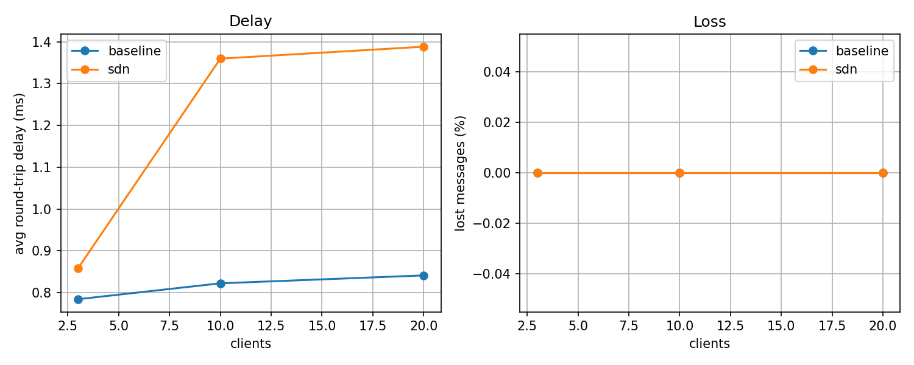

# PERSON3 - Scaling test: SDN vs baseline

## How to run
Activate the Ryu environment, then from the repo folder:

Baseline:
    ryu-manager ryu.app.simple_switch_13 &
    sudo python3 run_scaling.py --mode baseline
    pkill -f ryu-manager; sudo mn -c

SDN (our controller):
    ryu-manager controller.py &
    sudo python3 run_scaling.py --mode sdn
    pkill -f ryu-manager; sudo mn -c

Table and graph:
    python3 plot_results.py

Files: config.py (constants), load_clients.py (load generator), run_scaling.py (Mininet runner), plot_results.py (table + graph). Raw data is in results_raw.csv.

## Measurement method
- Network: one switch, a server (h1, 10.0.0.1) and 5 client hosts, plus a NAT node at 10.0.0.254 so the server's events (REGISTER, RATE) reach the controller.
- Each client logs in with REGISTER, then sends a private message to itself (PM <own name> ping<N>) 2 times per second for 30 seconds (60 messages per client).
- Round-trip delay is the time until the message comes back. A message that does not come back within 2 seconds counts as lost.
- Client counts: 3, 10 and 20, spread over the client hosts. The same test is run once with Ryu's plain simple_switch_13 (baseline) and once with our controller.py (SDN).

## Results
| clients | controller | avg delay (ms) | lost msgs | sent |
|---|---|---|---|---|
| 3 | baseline | 0.8 | 0 | 180 |
| 3 | sdn | 0.9 | 0 | 180 |
| 10 | baseline | 0.8 | 0 | 600 |
| 10 | sdn | 1.4 | 0 | 600 |
| 20 | baseline | 0.8 | 0 | 1200 |
| 20 | sdn | 1.4 | 0 | 1200 |

## Discussion
- No messages were lost in any test, for either controller, up to 20 clients.
- Average round-trip delay was about 0.8 ms for the baseline at every client count. With our SDN controller it was 0.9 ms at 3 clients and 1.4 ms at 10 and 20 clients.
- The SDN controller adds a small delay (about 0.1 to 0.6 ms), likely because of the extra per-user flow rules and event handling it does. This was not measured separately. The delay did not grow from 10 to 20 clients, so it scaled well in this setup.

## Limitations
- Each setting was run once, so very small differences may be noise.
- The baseline was recorded before the NAT node was given its 10.0.0.254 address; the NAT does not carry chat traffic, so the effect on the baseline should be negligible.
- All clients run on a single-switch topology with 5 client hosts.
