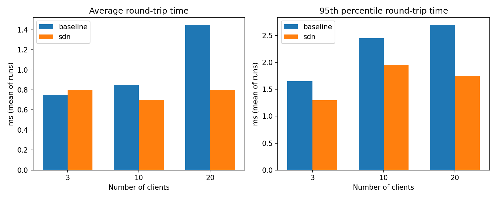
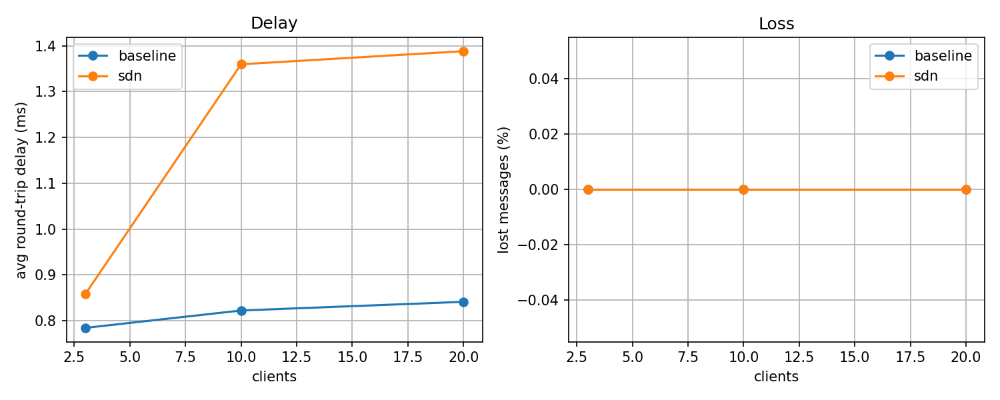

# Multi-Client Chat Network via SDN (Mininet + Ryu)

SDN-Socket Programming, Jackfruit Mini Project #8, "Multi-Client Chat Network" (PES University, Computer Networks).

A concurrent, multi-user TCP chat application running on a virtual Software-Defined Network. The project uses **cross-layer communication** in both directions:

- **Application to network:** the chat server reports application events (a user registers, joins a room, disconnects, sends N messages per second) to an SDN controller over UDP.
- **Network to application:** the controller turns those events into OpenFlow rules on the switch: per-user rules, traffic monitoring, rate-based blocking of flooders and, in the QoS controller, per-user meters.

## Table of Contents

- [Team](#team)
- [Implementation Plan](#implementation-plan)
- [Architecture](#architecture)
- [Files](#files)
- [OpenFlow Priority Levels](#openflow-priority-levels)
- [Application Events (Socket to SDN)](#application-events-socket-to-sdn)
- [Setup](#setup)
- [Running the Demo](#running-the-demo)
- [Supported Chat Commands](#supported-chat-commands)
- [Test Cases and Results](#test-cases-and-results)
- [Design Decisions](#design-decisions)
- [Limitations and Future Work](#limitations-and-future-work)

---

## Team

| Person | Name | D2 responsibility |
|---|---|---|
| Person 1 | Ritu Reddy | Controller monitoring, flood detection and blocking, `flooder.py`, `probe.py`, blocking on/off experiment, scaling experiment (`scaling_test.py`, `plot_scaling.py`), integration and repo |
| Person 2 | Pratham | QoS controller (`controller_qos.py`: per-user meters, VIP rooms), 3-switch topology (`topology_big.py`), VIP experiment |
| Person 3 | Prerana | Independent scaling measurement, baseline vs SDN (`run_scaling.py`, `load_clients.py`, `plot_results.py`, `SCALING_PERSON3.md`) |

Git workflow: each person worked on their own branch (`d2`, `person2-work`, `person3-work`); the branches were merged on `integration` and then into `main`.

---

## Implementation Plan

1. Build the TCP chat server and client: registration, rooms, private messages, one thread per client (D1).
2. Build the Mininet topology with one OpenFlow 1.3 switch, a Ryu controller and a NAT node (D1).
3. Send UDP events from the server to the controller; install and remove per-user flow rules (D1).
4. Add flow-stats monitoring, server-side message-rate reporting and timed flood blocking (D2).
5. Add per-user meters and VIP rooms (QoS controller) and a 3-switch topology (D2).
6. Measure scalability against a baseline controller, document the results and verify the repo from a fresh clone (D2).

---

## Architecture

The environment uses **Mininet** (virtual topology), **Open vSwitch** (OpenFlow 1.3) and **Ryu** (controller).

```text
                         +-----------------------------+
                         |        Ryu Controller       |
                         |  controller.py              |
                         |  controller_qos.py (+meters)|
                         |  - per-user rules (prio 150)|
                         |  - flow-stats monitoring    |
                         |  - flood block (prio 200)   |
                         +--------------^--------------+
                                        | UDP :9000 events
                                        | (via NAT node 10.0.0.254)
+----------------+              +-------+--------+
| Client h2      |              |                |
| 10.0.0.2       |--------------|     OVS s1     |
+----------------+              |  OpenFlow 1.3  |
+----------------+              |                |
| Client h3      |--------------|                |
| 10.0.0.3       |              +-------+--------+
+----------------+                      | TCP :5000
                                +-------+--------+
                                | Chat Server h1 |
                                | 10.0.0.1       |
                                +----------------+
```

The controller runs on the VM, outside Mininet. The NAT node (`nat0`, 10.0.0.254) lets the virtual network reach it, so the server's UDP events arrive at the controller.

### Data flow

1. A user sends a command (for example `REGISTER alice`) over **TCP** to the chat server.
2. The server handles it and sends a **UDP** event to the controller (for example `REGISTER alice 10.0.0.2`).
3. The controller installs, removes or changes OpenFlow rules on the switch.
4. Every second the server also reports each user's message rate (`RATE <name> <msgs_per_sec>`). If a user is above the limit, the controller installs a timed DROP rule for that user's IP.
5. Every 3 seconds the controller reads flow statistics from the switch and logs per-user packet rates.

---

## Files

| File | Description |
|------|-------------|
| `server.py` | TCP chat server on h1 (`10.0.0.1:5000`). One thread per client; a lock protects the shared client, room and user-location dictionaries. Sends UDP events and per-second `RATE` reports to the controller. |
| `client.py` | TCP client. A daemon thread prints incoming messages while the main thread reads input. |
| `topology.py` | Mininet topology: server h1, clients h2 and h3, one switch s1 (OpenFlow 1.3), NAT node `nat0`, remote controller at 127.0.0.1:6653. Starts `server.py` on h1 automatically. |
| `controller.py` | Ryu controller (OpenFlow 1.3): table-miss, MAC learning, chat flow rule, per-user rules, flow-stats monitoring, flood detection and blocking. Constants at the top of the file. |
| `controller_qos.py` | Subclass of `ChatController` that adds per-user meters and VIP rooms. `controller.py` is not modified. |
| `flooder.py` | Test client that registers as `flooder`, joins `room1` and sends messages at a chosen rate. |
| `probe.py` | Test client that measures round-trip time with private messages to itself, to show the effect of a flood on another user. |
| `scaling_test.py` | Load generator: N client threads, each sending messages at a fixed rate plus a once-per-second self-PM used to time round trips. Appends a row to `results.csv`. |
| `plot_scaling.py` | Reads `results.csv`, prints a summary table and saves `scaling.png`. |
| `results.csv`, `scaling.png` | Person 1 scaling results (baseline vs SDN). |
| `config.py`, `load_clients.py`, `run_scaling.py`, `plot_results.py` | Person 3 scaling test (runs its own Mininet topology). |
| `results_raw.csv`, `results_table.md`, `results.png`, `SCALING_PERSON3.md` | Person 3 results and write-up. |
| `topology_big.py` | Person 2: 3-switch tree (core s1, edge s2 and s3), server on h1, six clients, optional bandwidth limit on the server link. |
| `bulk.py`, `vip_probe.py`, `vip_experiment.py` | Person 2: VIP experiment (heavy senders, probes, runner). |
| `DEMO.md` | Step-by-step script for the live D2 demo. |
| `vip_results.csv`, `vip_experiment_results.png`, `README_person2.md` | Person 2 results and notes. |

---

## OpenFlow Priority Levels

The highest matching priority wins.

| Priority | Rule | Description |
|----------|------|-------------|
| **200** | Flood block | DROP for the offending user's IP (`tcp`, destination port 5000). Installed when the user's message rate exceeds the limit. `hard_timeout` of 30 s, so it removes itself. |
| **150** | User rule | Installed on `REGISTER` for the user's IP and TCP port 5000 (action `NORMAL`). Removed on `DISCONNECT`. The monitoring reads statistics from these rules. |
| **100** | Chat rule | Installed when TCP traffic on port 5000 reaches the controller. Idle timeout 60 s. In the QoS controller this is the rule that carries the meter. |
| **10** | Forwarding | Learned-MAC forwarding for other traffic. Idle timeout 60 s. |
| **0** | Table miss | Sends unmatched packets to the controller. |

Controller settings (top of `controller.py`): `STATS_INTERVAL = 3` seconds, `FLOOD_MSGS = 20` messages per second (can be overridden with the environment variable `FLOOD_MSGS`), `BLOCK_SECONDS = 30`.

---

## Application Events (Socket to SDN)

Sent by `server.py` over UDP to `10.0.0.254:9000`.

| Event | When | Controller reaction |
|-------|------|---------------------|
| `REGISTER <name> <ip>` | A user registers | Installs the priority-150 rule for that IP |
| `JOIN <name> <room>` | A user joins a room | Updates room membership (QoS controller re-evaluates the user's class) |
| `DISCONNECT <name>` | A user quits | Removes the user's priority-150 rule |
| `RATE <name> <msgs_per_sec>` | Every second, per user | If above `FLOOD_MSGS`, installs the priority-200 DROP rule for 30 s and logs `FLOOD DETECTED`; logs `UNBLOCKED` when it expires |

UDP is used because these are small, fire-and-forget notifications that should never slow down chat.

---

## Setup

Tested on Ubuntu 22.04 (ARM64) in a UTM virtual machine, Python 3.10.

**1. Mininet and Open vSwitch**

```bash
sudo apt install mininet xterm -y
```

Do **not** run `sudo apt upgrade` on the VM. On this setup it pulled in a kernel that broke an earlier VM's boot.

**2. Ryu 4.34 (needs fixes on Python 3.10)**

```bash
pip3 install ryu==4.34
pip3 install setuptools==67.6.1 eventlet==0.33.3 dnspython==2.2.1
sed -i 's/from eventlet.wsgi import ALREADY_HANDLED/ALREADY_HANDLED = b""/' \
    ~/.local/lib/python3.10/site-packages/ryu/app/wsgi.py
echo 'export PATH=$PATH:~/.local/bin' >> ~/.bashrc && source ~/.bashrc
```

**3. Plots (optional)**

```bash
sudo apt install python3-matplotlib -y
```

**4. Get the code**

```bash
git clone https://github.com/ritur08/sdn-chat.git
cd sdn-chat
```

No paths are hard-coded: `topology.py` finds `server.py` relative to its own folder.

**Between experiments**, always stop everything and clean up:

```bash
sudo mn -c
pgrep -af ryu-manager      # should print nothing; otherwise: pkill -f ryu-manager
```

---

## Running the Demo

Use one terminal tab per step. The controller runs on the VM; Mininet hosts are entered through `mnexec`.

**1. Controller (tab 1)**

```bash
cd ~/sdn-chat
ryu-manager --ofp-tcp-listen-port 6653 controller_qos.py   # controller with QoS
# or: ryu-manager controller.py                            # flood blocking only
```

Wait for `listening for chat events on UDP 9000`.

**2. Topology (tab 2)**

```bash
cd ~/sdn-chat
sudo python3 topology.py
```

At the `mininet>` prompt:

```text
pingall            # expect 0% dropped (12/12 received)
h2 echo $$         # note the number (changes every run)
h3 echo $$
```

**3. Open shells inside hosts (new tabs, as many as needed)**

```bash
sudo mnexec -a <h2 number> bash
cd /home/<your-user>/sdn-chat      # inside host shells "~" means /root, so use the full path
python3 client.py 10.0.0.1
```

Type `REGISTER alice`, `JOIN room1`. In another tab use the h3 number for `bob`: `REGISTER bob`, `JOIN room1`, `MSG hello`, `PM alice hi`.

**4. Inspect the switch (any VM tab)**

```bash
sudo ovs-ofctl -O OpenFlow13 dump-flows s1               # priority 150 rules appear after REGISTER
sudo ovs-ofctl -O OpenFlow13 dump-meters s1              # QoS controller only
```

**5. Flood scenario (inside an h3 shell)**

```bash
python3 flooder.py 10.0.0.1 100 20       # 100 msgs/s for 20 s
```

Within 30 s, in a VM tab:

```bash
sudo ovs-ofctl -O OpenFlow13 dump-flows s1 | grep priority=200   # DROP rule for 10.0.0.3
```

Run it again after about 35 s: nothing is listed, and the controller log shows `UNBLOCKED`.

**6. Blocking on/off experiment**

In an h2 shell run the probe while the flooder runs in an h3 shell:

```bash
python3 probe.py 10.0.0.1 25
```

For the "blocking off" run, start the controller with `FLOOD_MSGS=100000 ryu-manager controller.py` and repeat.

**7. Scaling experiment (inside an h2 shell, folder of the repo)**

```bash
for r in 1 2; do for n in 3 10 20; do python3 scaling_test.py 10.0.0.1 $n 2 20 sdn; sleep 4; done; done
python3 plot_scaling.py
```

Use the label `baseline` when the controller is `ryu-manager ryu.app.simple_switch_13`. Arguments: server IP, clients, messages per second per client, seconds, label. `results.csv` is written from inside the host shell and is owned by root; run `sudo chown $USER results.csv` before committing.

**8. Person 3 scaling run (its own topology)**

```bash
ryu-manager ryu.app.simple_switch_13 &
sudo python3 run_scaling.py --mode baseline
pkill -f ryu-manager; sudo mn -c
ryu-manager controller.py &
sudo python3 run_scaling.py --mode sdn
pkill -f ryu-manager; sudo mn -c
python3 plot_results.py
```

**9. VIP / QoS experiment (Person 2, 3-switch topology)**

```bash
ryu-manager --ofp-tcp-listen-port 6653 controller.py        # baseline
sudo python3 vip_experiment.py --label baseline
sudo mn -c
ryu-manager --ofp-tcp-listen-port 6653 controller_qos.py    # QoS
sudo python3 vip_experiment.py --label qos
```

Results are appended to `vip_results.csv`.

---

## Supported Chat Commands

Names and rooms contain no spaces. Names are case-sensitive.

| Command | Description | SDN behaviour |
|---------|-------------|---------------|
| `REGISTER <name>` | Registers the session | Controller installs the priority-150 rule for the host IP |
| `JOIN <room>` | Enters a room | Controller updates room membership |
| `MSG <text>` | Broadcasts to the current room | Counted by the server for `RATE` reports |
| `PM <user> <text>` | Private message | Counted by the server for `RATE` reports |
| `USERS` | Lists active users | none |
| `LEAVE` | Leaves the current room | none |
| `QUIT` | Disconnects | `DISCONNECT` event; controller removes the priority-150 rule |

Server replies include `OK registered as X`, `[room] user: text`, `[PM from X] text`, `[PM to X] text` and `ERR ...` for errors.

---

## Test Cases and Results

All results below were measured in a single UTM virtual machine, so CPU is shared between Mininet, the controller, the server and the clients. Run counts are small; see the limitations.

### Functional and SDN test cases

| # | Test | Expected | Result |
|---|------|----------|--------|
| 1 | `pingall` | 0% dropped | 12/12 received (h1, h2, h3, nat0) |
| 2 | alice and bob register, join `room1`; bob sends `MSG hello` and `PM alice hi` | alice receives `[room1] bob: hello` and `[PM from bob] hi` | Pass (also from a fresh clone) |
| 3 | Priority-150 rule after `REGISTER` | One rule per registered IP | Pass |
| 4 | `QUIT` | Rule removed (`EVENT disconnect ... rule removed`) | Pass |
| 5 | Monitoring during normal chat | `STATS` lines every 3 s | About 0.2 to 0.7 pkt/s per user |
| 6 | Flood: `flooder.py 10.0.0.1 100 20` | Detected, blocked at the switch, unblocked after 30 s | Pass. Detected within about 2 s, rule `priority=200,tcp,nw_src=10.0.0.3,tp_dst=5000,hard_timeout=30,actions=drop`, then `UNBLOCKED`. Verified on `controller.py` and on `controller_qos.py`, and from a fresh clone. |
| 7 | Fresh clone of the repo, full demo from the clone | Everything runs without local files | Pass |

### Flood blocking, on vs off

A probe user in `room1` sent a private message to itself every 0.2 s while the flooder sent 100 messages per second for 20 s. One run per setting.

| | Pings sent | Lost | Avg RTT | Max RTT | Spam messages received by probe |
|---|---|---|---|---|---|
| Blocking on | 123 | 0 | 1.6 ms | 34.6 ms | 102 |
| Blocking off (`FLOOD_MSGS=100000`) | 124 | 0 | 3.2 ms | 46.5 ms | 1702 |

Blocking removed about 94% of the spam that reached other users. The latency difference is within single-run noise, so the reliable result is the reduction in spam, not the RTT. The probe user was not blocked (see Design Decisions).

### Scalability: baseline vs SDN (Person 1)

Each client sends 2 messages per second for 20 s, plus one self-PM per second that is timed. Baseline is Ryu's `simple_switch_13`; SDN is `controller.py`. Two runs per setting; the table shows the mean of the runs (max is the worst run). Topology: one switch, h1, h2, h3.

| Clients | Controller | Avg RTT (ms) | p95 (ms) | Max (ms) | Lost |
|---|---|---|---|---|---|
| 3 | baseline | 0.75 | 1.65 | 4.7 | 0 / 120 |
| 3 | SDN | 0.80 | 1.30 | 4.4 | 0 / 120 |
| 10 | baseline | 0.85 | 2.45 | 19.6 | 0 / 400 |
| 10 | SDN | 0.70 | 1.95 | 5.2 | 0 / 400 |
| 20 | baseline | 1.45 | 2.70 | 64.1 | 0 / 800 |
| 20 | SDN | 0.80 | 1.75 | 5.8 | 0 / 800 |



### Scalability: second, independent measurement (Person 3)

Different setup: 5 client hosts, 30 s per run, 2 messages per second per client, one run per setting.

| Clients | Controller | Avg delay (ms) | Lost | Sent |
|---|---|---|---|---|
| 3 | baseline | 0.8 | 0 | 180 |
| 3 | SDN | 0.9 | 0 | 180 |
| 10 | baseline | 0.8 | 0 | 600 |
| 10 | SDN | 1.4 | 0 | 600 |
| 20 | baseline | 0.8 | 0 | 1200 |
| 20 | SDN | 1.4 | 0 | 1200 |



### Reading the scaling results

- No message was lost for either controller, with up to 20 clients, in both measurements.
- Average round-trip time stayed at about 1 ms or below in nearly every case and under 1.5 ms in all of them.
- The two measurements do not agree on overhead. Person 1 saw no consistent difference between baseline and SDN. Person 3 saw the SDN controller about 0.1 to 0.6 ms slower at 10 and 20 clients. The honest conclusion is that the SDN controller, with per-user rules and monitoring, adds at most a small delay (under about 0.6 ms in these runs) and does not cost any messages up to 20 clients. These runs do not show the SDN controller being faster.
- The large maximum values for the baseline (42 ms and 64 ms at 20 clients in Person 1's runs) are most likely CPU contention in the single VM, not network congestion. This was not measured separately.

### QoS and VIP experiment (Person 2, `topology_big.py`)

Setup: 3-switch tree, 2 Mbit/s bottleneck on the server link, three heavy normal users offering 1.6 Mbit/s each, plus a VIP probe and a normal probe sending 20 KB messages every 2 s. Per-user meter: 500 kbps, 100 kbit burst, drop band. VIP rooms (`vip`) are exempt from the meter. Baseline is `controller.py`; QoS is `controller_qos.py`.

| Run | VIP probe avg delay | Normal probe avg delay | Heavy users delivered (each) |
|---|---|---|---|
| Baseline (no QoS) | 24,677 ms | 24,873 ms | 600 to 620 kbps |
| QoS, run 1 | 5,573 ms | 5,230 ms | 583 to 610 kbps |
| QoS, run 2 | 412 ms | 387 ms | 436 to 444 kbps |

- With the meters effective (run 2), chat delay fell by about 60 times and the heavy users were held near the 500 kbps limit (336 packets dropped by meter 102 on s2).
- In run 1 the heavy users were not throttled. Person 2's notes point out that meters attach to flows created when chat traffic reaches the controller, so previously learned L2 flows can hide the traffic; the experiment script clears them before starting.
- Under QoS the VIP and normal probes see similar delay, because the delay came from the heavy users and the meters fix that for everyone. The result is "rate limiting protects chat delay", not "VIP chat is faster". In a separate test reported by Person 2, the same heavy sender delivered 1595 kbps as a VIP and 407 kbps as a normal user.
- One run per case.

### Meters in the single-switch demo

With `controller_qos.py` on `topology.py`, meters 102 and 103 are created (`dump-meters`), but `meter-stats` showed `flow_count:0` and zero packets for both. Client upload traffic matches the priority-150 user rule (`actions=NORMAL`), which carries no meter; meters are attached to priority-100 chat flows. So in the single-switch demo the meters exist but do not limit client uploads. The metering effect is demonstrated in the 3-switch experiment above. We have not fully analysed why the two setups differ.

---

## Design Decisions

- **TCP for chat, UDP for controller events.** Chat needs reliable, ordered delivery. Controller events are small notifications that must not slow the chat server down.
- **One thread per client, with a lock.** Each client blocks on its own socket. The lock protects the shared client, room and user-location dictionaries from concurrent modification.
- **NAT node.** The controller runs on the VM, outside the virtual network. The NAT node gives h1 a route to it, so UDP events can arrive.
- **Block at the switch, with `hard_timeout`.** Dropping at the switch stops the flood before it reaches the server, and the rule removes itself after 30 s with no extra controller logic.
- **The server counts messages, not the controller counting packets.** The first version blocked on raw packet rate (30 pkt/s) and wrongly blocked an innocent probe user: TCP ACKs for the spam they received pushed their packet rate to about 81 pkt/s. The server now counts real chat messages and reports `RATE`, so detection is application-aware and the false positive is gone. This is the cross-layer design in practice.
- **QoS as a subclass.** `controller_qos.py` extends `ChatController` instead of editing it, so the flood-blocking controller keeps working unchanged.

---

## Limitations and Future Work

- **Blocking is per host IP.** Users who share a host are blocked together, and the controller log may show another user's name for that IP. We saw this when `flooder` and `bob` ran on h3: the log said `bob` was blocked.
- **UDP events have no retry and no ordering guarantee.** A lost event is not recovered, and events can arrive out of order (once a `JOIN` was logged before its `REGISTER`; a `RATE` report can also arrive after `DISCONNECT`).
- **`controller.py` tracks a single switch.** The datapath is stored in one variable that is overwritten by whichever switch connects last. The per-user rules and flood blocking therefore apply to one switch. `controller_qos.py` keeps a dictionary of switches for its own rules, but multi-switch routing and blocking for the whole network are not implemented.
- **Meters do not apply in the single-switch demo** (see above). The QoS result comes from the 3-switch experiment.
- **Virtual links have unlimited bandwidth** in `topology.py`, so latency differences are small. Only the QoS experiment limits a link.
- **One VM, few runs.** Everything shares one VM's CPU. The scaling and QoS results come from one or two runs per setting, so small differences are noise.
- **Plain text, no authentication.** Chat is unencrypted and usernames are not authenticated.
- **Not tested:** link failure, controller failure and recovery, and more than 20 clients.

Future work: block per user instead of per IP; add retry or acknowledgement for controller events; track multiple switches in the base controller; apply meters on the priority-150 path; test link and controller failure.
